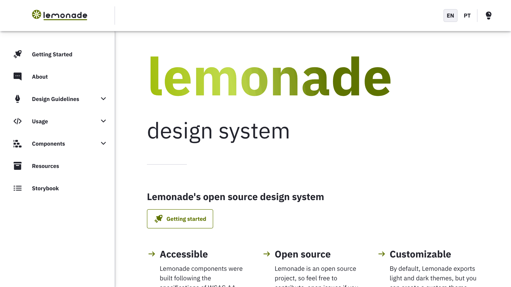
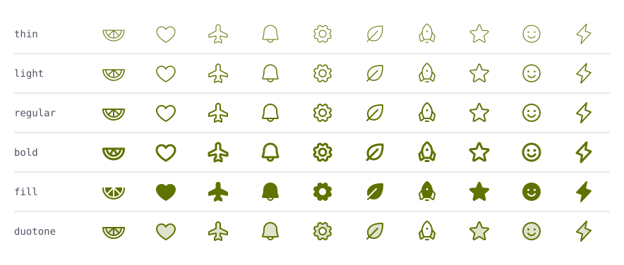

<div align="center">

<a href="https://lemonade-ui.llypedev.com.br">
  <picture>
    <source media="(prefers-color-scheme: dark)" srcset=".github/assets/logo-lemonade-dark.svg" />
    
  </picture>
</a>

### Implementação em React do Lemonade Design System

Componentes React acessíveis, personalizáveis por tema e totalmente tipados para construir interfaces consistentes.

[](https://github.com/llypeDev/lemonade-ui/actions/workflows/yarn.yml)
[](https://github.com/llypeDev/lemonade-ui/actions/workflows/loki.yml)
[](https://codecov.io/gh/llypeDev/lemonade-ui)
[](./LICENSE)
[](https://github.com/llypeDev/lemonade-ui/actions/workflows/pages.yml)


[](https://lemonade-ui.llypedev.com.br)

🌐 **[lemonade-ui.llypedev.com.br](https://lemonade-ui.llypedev.com.br/pt/)**

[**Documentação**](https://lemonade-ui.llypedev.com.br/pt/) ·
[**Storybook**](https://lemonade-ui.llypedev.com.br/storybook) ·
[**Primeiros passos**](https://lemonade-ui.llypedev.com.br/pt/getting-started) ·
[**Como contribuir**](./CONTRIBUTING.md)

[English](./README.md) · **Português**

</div>

---

## Sumário

- [Destaques](#-destaques)
- [Site no ar](#-site-no-ar)
- [Instalação](#-instalação)
- [Início rápido](#-início-rápido)
- [Temas](#-temas)
- [Internacionalização](#-internacionalização)
- [Ícones](#-ícones)
- [Componentes](#-componentes)
- [Desenvolvimento](#-desenvolvimento)
- [Como contribuir](#-como-contribuir)
- [Licença](#-licença)

## ✨ Destaques

<table>
  <tr>
    <td width="33%" valign="top">
      <b>🧩 117 componentes</b><br />
      Botões, formulários, seletores de data, tabelas, modais, drawers, popovers, toasts, menu lateral e primitivas de layout.
    </td>
    <td width="33%" valign="top">
      <b>♿ Acessível</b><br />
      Segue o nível AA da WCAG: navegação por teclado, foco visível, atributos ARIA e contraste verificado.
    </td>
    <td width="33%" valign="top">
      <b>🎨 Temas</b><br />
      Temas claro e escuro prontos, e <code>createTheme</code> para usar suas próprias escalas de cor.
    </td>
  </tr>
  <tr>
    <td width="33%" valign="top">
      <b>🌍 Pronto para i18n</b><br />
      Os textos dos componentes vêm de um <code>LocaleContext</code>, com <code>en-US</code> e <code>pt-BR</code> incluídos.
    </td>
    <td width="33%" valign="top">
      <b>💠 1.982 ícones</b><br />
      470 ícones do sistema e a família Phosphor completa: 1.512 ícones em 6 pesos, importados um a um.
    </td>
    <td width="33%" valign="top">
      <b>🟦 TypeScript</b><br />
      Escrito em TypeScript e publicado com as declarações de tipo.
    </td>
  </tr>
</table>

## 🌐 Site no ar

A documentação e o Storybook estão publicados em **[lemonade-ui.llypedev.com.br](https://lemonade-ui.llypedev.com.br/pt/)**, em português e inglês.

<p align="center">
  <a href="https://lemonade-ui.llypedev.com.br">
    <picture>
      <source media="(prefers-color-scheme: dark)" srcset=".github/assets/site-preview-dark.png" />
      
    </picture>
  </a>
</p>

| Página                      | Link                                                                                                                                                   |
| --------------------------- | ------------------------------------------------------------------------------------------------------------------------------------------------------ |
| Documentação                | [Português](https://lemonade-ui.llypedev.com.br/pt/) · [English](https://lemonade-ui.llypedev.com.br/en/)                                              |
| Primeiros passos            | [lemonade-ui.llypedev.com.br/pt/getting-started](https://lemonade-ui.llypedev.com.br/pt/getting-started)                                               |
| Storybook                   | [lemonade-ui.llypedev.com.br/storybook](https://lemonade-ui.llypedev.com.br/storybook)                                                                 |
| Tema                        | [lemonade-ui.llypedev.com.br/pt/usage/theme](https://lemonade-ui.llypedev.com.br/pt/usage/theme)                                                       |
| Internacionalização         | [lemonade-ui.llypedev.com.br/pt/usage/i18n](https://lemonade-ui.llypedev.com.br/pt/usage/i18n)                                                         |
| Visão geral dos componentes | [lemonade-ui.llypedev.com.br/pt/components/overview](https://lemonade-ui.llypedev.com.br/pt/components/overview)                                       |
| Explorador Phosphor         | [lemonade-ui.llypedev.com.br/pt/design-guidelines/iconography/phosphor](https://lemonade-ui.llypedev.com.br/pt/design-guidelines/iconography/phosphor) |

O site é gerado e publicado no GitHub Pages a cada push na `main` pelo workflow [Deploy site to GitHub Pages](https://github.com/llypeDev/lemonade-ui/actions/workflows/pages.yml).

## 📦 Instalação

**Requisitos:** React e React DOM `>= 16.8` (a biblioteca usa hooks).

```sh
# com npm
npm install @lemonade/ui --save

# com yarn
yarn add @lemonade/ui
```

### Fonte: IBM Plex Sans

O Lemonade foi desenhado para a [IBM Plex Sans](https://fonts.google.com/specimen/IBM+Plex+Sans), nos estilos _regular_ e _bold_. Adicione-a ao `<head>` da sua aplicação:

```html
<link href="https://fonts.googleapis.com/css?family=IBM+Plex+Sans:400,400i,700,700i" rel="stylesheet" />
```

## 🚀 Início rápido

Envolva a aplicação com o `ThemeProvider`. Além de fornecer o tema, ele injeta os estilos globais (fonte, cores, `box-sizing` e reset dos títulos) que os componentes esperam.

```jsx
import React from 'react'
import ReactDOM from 'react-dom'
import { Button, ThemeProvider } from '@lemonade/ui'

const App = () => (
  <ThemeProvider>
    <Button kind='primary'>Olá, mundo</Button>
  </ThemeProvider>
)

ReactDOM.render(<App />, document.querySelector('#root'))
```

Um exemplo um pouco maior, combinando componentes de layout, formulário e feedback:

```jsx
import { Alert, Button, Cell, Grid, Icon, TextField, Tooltip } from '@lemonade/ui'

function FormularioCadastro() {
  return (
    <Grid>
      <Cell size={12}>
        <Alert type='info'>Os campos marcados com * são obrigatórios.</Alert>
      </Cell>

      <Cell size={6}>
        <TextField name='nome' label='Nome' placeholder='Seu nome completo' required />
      </Cell>

      <Cell size={6}>
        <TextField name='email' label='E-mail' error='Informe um e-mail válido' required />
      </Cell>

      <Cell size={12}>
        <Tooltip text='Criar sua conta'>
          <Button kind='primary' type='submit'>
            <Icon icon='plus' style={{ marginRight: '0.5rem' }} />
            Cadastrar
          </Button>
        </Tooltip>
      </Cell>
    </Grid>
  )
}
```

O `Button` aceita `kind` (`normal` · `primary` · `danger`), `skin` (`default` · `outline` · `ghost`) e `size` (`small` · `medium` · `large`). Todas as props de cada componente estão no [Storybook](https://lemonade-ui.llypedev.com.br/storybook).

## 🎨 Temas

O Lemonade exporta dois temas: `lightTheme` (padrão) e `darkTheme`. O tema escuro inverte todas as escalas de cor, então os componentes se adaptam sem código extra.

```jsx
import { darkTheme, ThemeProvider } from '@lemonade/ui'

const App = () => <ThemeProvider theme={darkTheme}>{/* ... */}</ThemeProvider>
```

A cor da marca é a escala **lemon**. O `c40` (`#5E7300`) é o `pallete.primary.main` e tem contraste de 5,35:1 sobre o branco:

<p align="center">
  
</p>

### Tema personalizado

Use `createTheme` para montar um tema a partir de qualquer escala de cor. Todas as escalas estão em `colors` (`lemon`, `blue`, `gray`, `green`, `orange`, `pink`, `purple`, `red`, `turquoise` e `yellow`):

```jsx
import { Button, colors, createTheme, ThemeProvider } from '@lemonade/ui'

const meuTema = createTheme({
  pallete: {
    primaryScale: colors.pink,
  },
})

const App = () => (
  <ThemeProvider theme={meuTema}>
    <Button kind='primary'>Meu tema personalizado!</Button>
  </ThemeProvider>
)
```

Outras escalas que podem ser substituídas: `grayScale`, `successScale`, `dangerScale`, `alertScale`, `infoScale` e `highlightScale`. Veja exemplos ao vivo no [guia de temas](https://lemonade-ui.llypedev.com.br/pt/usage/theme).

### Estilizando seus próprios componentes

O `useStyles` dá acesso ao tema atual e devolve nomes de classe do Emotion, então seus componentes acompanham o tema (inclusive o modo escuro):

```jsx
import { useStyles } from '@lemonade/ui'

function Banner({ children }) {
  const { classes } = useStyles((theme) => ({
    banner: {
      padding: '1rem',
      background: theme.pallete.primary.c90,
      color: theme.pallete.primary.c10,
      borderRadius: theme.radius.paper,
    },
  }))

  return <div className={classes.banner}>{children}</div>
}
```

A maioria dos componentes também aceita a prop `style` com um objeto de estilos do Emotion, para ajustes pontuais. Use `useTheme()` quando precisar apenas ler valores do tema.

## 🌍 Internacionalização

Os textos dos componentes (paginação, calendário, mensagens de formulário etc.) vêm do `LocaleContext`. O inglês (`en-US`) é o padrão; o `pt-BR` já vem no pacote:

```jsx
import { LocaleContext, Paginator } from '@lemonade/ui'
import ptBR from '@lemonade/ui/lib/i18n/locales/pt-BR'

const App = () => (
  <LocaleContext.Provider value={ptBR}>
    <Paginator page={5} total={10} />
  </LocaleContext.Provider>
)
```

Para outro idioma, crie um objeto com o mesmo formato de `LocaleConfiguration` e passe-o ao provider. Leia os textos atuais com a hook `useLocale()`. Mais detalhes no [guia de i18n](https://lemonade-ui.llypedev.com.br/pt/usage/i18n).

## 💠 Ícones

O Lemonade traz duas famílias de ícones que funcionam juntas:

|                 | Ícones do sistema Lemonade                               | Ícones Phosphor                                                               |
| --------------- | -------------------------------------------------------- | ----------------------------------------------------------------------------- |
| **Quantidade**  | 470                                                      | 1.512, cada um em 6 pesos                                                     |
| **Importação**  | `Icon` de `@lemonade/ui`                                 | Componentes `Ph*` de `@lemonade/ui/phosphor`                                  |
| **Quando usar** | Ações centrais da interface (grid de 24px, traço de 2px) | Temas que o conjunto do sistema não cobre, ou quando precisar de outros pesos |

### Ícones do sistema Lemonade

Todos os ícones do sistema são renderizados pelo componente `Icon`. O nome é a forma camelCase do nome do arquivo SVG em [`icons/`](./icons) (por exemplo, `angle-down.svg` → `angleDown`):

```jsx
import { Icon } from '@lemonade/ui'

<Icon icon='lemonade' />
<Icon icon='checkCircleFilled' fill='success' size={2} />
```

| Prop    | Descrição                                                                                                                                |
| ------- | ---------------------------------------------------------------------------------------------------------------------------------------- |
| `icon`  | Nome do ícone, ou qualquer componente React de SVG (inclusive os ícones Phosphor).                                                       |
| `fill`  | Cor do tema: `normal`, `primary`, `secondary`, `disabled`, `danger`, `success`, `info`, `alert` ou `inherit`. O padrão é `currentColor`. |
| `size`  | Tamanho em `rem`. O padrão é `1.5`.                                                                                                      |
| `style` | Estilos extras do Emotion.                                                                                                               |

Veja o conjunto completo em [lemonade-ui.llypedev.com.br](https://lemonade-ui.llypedev.com.br).

### Ícones Phosphor

<p align="center">
  <picture>
    <source media="(prefers-color-scheme: dark)" srcset=".github/assets/phosphor-weights-dark.svg" />
    
  </picture>
</p>

A família completa [Phosphor](https://phosphoricons.com) (v2.1.1) fica no próprio repositório e é publicada junto com o pacote, então funciona offline e só muda quando a atualizamos de propósito.

Cada ícone é um componente React chamado `Ph` + o nome do ícone em PascalCase (`arrow-circle-up` → `PhArrowCircleUp`). O prefixo evita conflito com os componentes do Lemonade: `PhLink` é o ícone, `Link` é o componente. Use imports nomeados, assim os bundlers incluem só os ícones que você usa:

```jsx
import { PhAirplane, PhHeart } from '@lemonade/ui/phosphor'

<PhAirplane />
<PhHeart weight='fill' size={32} color='#5E7300' />
```

| Prop             | Tipo                                                              | Padrão         |
| ---------------- | ----------------------------------------------------------------- | -------------- |
| `weight`         | `'thin' \| 'light' \| 'regular' \| 'bold' \| 'fill' \| 'duotone'` | `'regular'`    |
| `size`           | `number \| string`                                                | `'1em'`        |
| `color`          | `string`                                                          | `currentColor` |
| `mirrored`       | `boolean` (espelha o ícone, útil em RTL)                          | `false`        |
| `duotoneColor`   | `string`                                                          | cor do ícone   |
| `duotoneOpacity` | `number`                                                          | `0.2`          |
| `title`          | `string` (nome acessível)                                         | —              |

Qualquer outro atributo de SVG (`className`, `style`, `onClick`, `aria-*`…) é repassado ao `<svg>`, e as refs apontam para ele. Por padrão os ícones seguem o tamanho da fonte e a cor do texto ao redor, então se adaptam aos temas claro e escuro.

**Padrões para uma seção inteira.** Envolva parte da interface com o `PhosphorIconProvider`. Os providers podem ser aninhados, e as props de um ícone sempre têm prioridade:

```jsx
import { PhBell, PhGear, PhHouse, PhosphorIconProvider } from '@lemonade/ui/phosphor'

const BarraDeFerramentas = () => (
  <PhosphorIconProvider weight='duotone' size={24}>
    <PhHouse />
    <PhBell />
    <PhGear weight='bold' />
  </PhosphorIconProvider>
)
```

**Com o componente `Icon`.** Passe um ícone Phosphor para o `Icon` para ter o mesmo tamanho em `rem` e as cores do tema dos ícones do sistema:

```jsx
import { Icon } from '@lemonade/ui'
import { PhRocketLaunch } from '@lemonade/ui/phosphor'

const Exemplo = () => <Icon icon={PhRocketLaunch} size={2} fill='primary' />
```

**Acessibilidade.** Os ícones são decorativos por padrão (`aria-hidden`). Quando um ícone tem significado sozinho, como num botão só com ícone, dê um nome a ele com `title` ou `aria-label`, ou nomeie o botão:

```jsx
<PhTrash title='Excluir arquivo' />
```

**Misturando as famílias.** Evite colocar as duas famílias lado a lado no mesmo grupo de controles. Se precisar, use o peso `regular`, que é o mais próximo dos ícones do sistema.

Busque, visualize, copie e baixe todos os ícones no [explorador Phosphor](https://lemonade-ui.llypedev.com.br/pt/design-guidelines/iconography/phosphor). Os ícones Phosphor têm licença MIT; veja o [THIRD_PARTY_NOTICES.md](./THIRD_PARTY_NOTICES.md).

## 🧩 Componentes

| Categoria             | Componentes                                                                                                                                                                                                                                                                                                                                                         |
| --------------------- | ------------------------------------------------------------------------------------------------------------------------------------------------------------------------------------------------------------------------------------------------------------------------------------------------------------------------------------------------------------------- |
| **Ações**             | `Button` · `ButtonGroup` · `SplitButton` · `CopyButton` · `ToggleButton` · `Toolbar` · `SegmentedControl` · `Dropdown` · `ContextMenu` · `Link`                                                                                                                                                                                                                     |
| **Formulários**       | `TextField` · `TextArea` · `InlineEdit` · `MaskedTextField` · `PasswordField` · `PinInput` · `NumberField` · `Slider` · `Rating` · `ColorField` · `Chip` · `ChipGroup` · `Select` (obsoleto) · `SelectInline` · `Combobox` · `TagInput` · `TransferList` · `Checkbox` · `Radio` · `Switch` · `FileUploader` · `FormControl` · `Fieldset` · `ErrorSummary` · `Input` |
| **Data e hora**       | `Calendar` · `DateField` · `DateRangePicker` · `TimeField` · `DateTimeField` · `MonthField` · `MonthPicker` · `MonthRangePicker` · `MonthPaginator` · `RelativeTime`                                                                                                                                                                                                |
| **Feedback**          | `Alert` · `Banner` · `Toast` · `NotificationCenter` · `ActionableToast` (obsoleto) · `Modal` · `ConfirmDialog` · `Drawer` · `Popover` · `Tour` · `Tooltip` · `Toggletip` · `Spinner` · `ProgressCircle` · `Meter` · `Skeleton` · `LoadingOverlay` · `EmptyState` · `Progress` · `Status` · `Tag` · `Badge` · `InfoLabel`                                            |
| **Navegação**         | `AppHeader` · `CommandPalette` · `SideNav` · `SideNavGroup` · `SideNavItem` · `Breadcrumb` · `Tabs` · `Paginator` · `Stepper` · `SkipLink` · `TableOfContents` · `BackToTop`                                                                                                                                                                                        |
| **Exibição de dados** | `Table` · `DataTable` · `PagedTable` · `DescriptionList` · `List` · `ListItem` · `SortableList` · `Timeline` · `Stat` · `TreeView` · `CodeBlock` · `ImageViewer` · `Carousel` · `Avatar` · `AvatarGroup` · `Number` · `Currency` · `Highlight`                                                                                                                      |
| **Ícones**            | `Icon` · `PhosphorIconProvider` · 1.512 ícones `Ph*` de `@lemonade/ui/phosphor`                                                                                                                                                                                                                                                                                     |
| **Layout**            | `Grid` · `Cell` · `Flow` · `HFlow` (obsoleto) · `VFlow` (obsoleto) · `Accordion` · `Card` · `ClickableCard` · `ToggleCard` · `ExpandableCard` · `Paper` · `Divider` · `Splitter` · `StickyContainer` · `Portal` · `RootRef`                                                                                                                                         |
| **Tipografia**        | `Text` · `Heading` · `HeadingSection` · `VisuallyHidden` · `Kbd` · `ExpandableText` · `TruncatedText`                                                                                                                                                                                                                                                               |

Os gráficos (`Chart`, `BarChart`, `PieChart` e suas partes) vêm de uma entrada separada, `@lemonade/ui/lib/components/Chart`, para que aplicações que não desenham gráficos não carreguem as dependências deles. Os componentes marcados como obsoletos continuam funcionando, e a documentação deles indica o substituto.

Exemplos interativos e a API completa de cada componente estão no [Storybook](https://lemonade-ui.llypedev.com.br/storybook). As diretrizes de uso de cada um estão na [visão geral dos componentes](https://lemonade-ui.llypedev.com.br/pt/components/overview).

### ✨ Novidades

Componentes e melhorias adicionados desde a versão 1.4.0, cada um com demos interativas e notas de acessibilidade no site:

| Componente                                 | Para que serve                                                                                   | Documentação                                                                        |
| ------------------------------------------ | ------------------------------------------------------------------------------------------------ | ----------------------------------------------------------------------------------- |
| `SplitButton`                              | Ação principal com um botão ao lado que abre ações relacionadas                                  | [Documentação](https://lemonade-ui.llypedev.com.br/components/split-button)         |
| `Toggletip`                                | Botão de informação que mostra uma explicação com links ao clicar                                | [Documentação](https://lemonade-ui.llypedev.com.br/components/toggletip)            |
| `NotificationCenter`                       | Sino com o número de não lidas e um painel com as últimas notificações                           | [Documentação](https://lemonade-ui.llypedev.com.br/components/notification-center)  |
| `Carousel`                                 | Slides com setas, indicadores, deslizar e botão de pausa, como no padrão ARIA                    | [Documentação](https://lemonade-ui.llypedev.com.br/components/carousel)             |
| `ColorField`                               | Amostras como botões de opção, campo hexadecimal e o seletor de cores do navegador               | [Documentação](https://lemonade-ui.llypedev.com.br/components/color-field)          |
| `BackToTop`                                | Botão flutuante que volta ao topo de páginas longas                                              | [Documentação](https://lemonade-ui.llypedev.com.br/components/back-to-top)          |
| Itens do `Dropdown`                        | Ícones, atalhos, itens de marcar e de opção, grupos e submenus                                   | [Documentação](https://lemonade-ui.llypedev.com.br/components/dropdown)             |
| `TagInput`                                 | Valores livres, como e-mails, digitados ou colados como etiquetas, com validação                 | [Documentação](https://lemonade-ui.llypedev.com.br/components/tag-input)            |
| `DateTimeField`                            | Data e hora em um só campo, com um único valor `Date`                                            | [Documentação](https://lemonade-ui.llypedev.com.br/components/date-time-field)      |
| `TransferList`                             | Duas listas com botões que movem os itens marcados entre elas, com busca                         | [Documentação](https://lemonade-ui.llypedev.com.br/components/transfer-list)        |
| `TableOfContents`                          | Links "Nesta página" que marcam a seção sendo lida conforme a página rola                        | [Documentação](https://lemonade-ui.llypedev.com.br/components/table-of-contents)    |
| `TruncatedText`                            | Texto cortado com reticências, mostrado inteiro em uma tooltip só quando é cortado               | [Documentação](https://lemonade-ui.llypedev.com.br/components/truncated-text)       |
| `ImageViewer`                              | Imagens na tela inteira, com zoom, setas e legendas                                              | [Documentação](https://lemonade-ui.llypedev.com.br/components/image-viewer)         |
| Seleção de linhas no `DataTable`           | Checkboxes para selecionar linhas, selecionar todas e uma barra de ações em lote                 | [Documentação](https://lemonade-ui.llypedev.com.br/components/table)                |
| `Tabs` vertical · `TabPanel`               | Abas empilhadas ao lado do conteúdo e painéis ligados às suas abas                               | [Documentação](https://lemonade-ui.llypedev.com.br/components/tabs)                 |
| `SortableList`                             | Lista que o usuário ordena arrastando ou pelo teclado, com anúncios para leitores de tela        | [Documentação](https://lemonade-ui.llypedev.com.br/components/sortable-list)        |
| `Splitter`                                 | Dois painéis com um divisor que o usuário arrasta, ou move pelo teclado, para redimensioná-los   | [Documentação](https://lemonade-ui.llypedev.com.br/components/splitter)             |
| `ErrorSummary`                             | Erros de um formulário listados no topo depois do envio, cada um com link para o campo           | [Documentação](https://lemonade-ui.llypedev.com.br/components/error-summary)        |
| `ContextMenu`                              | Menu de ações no clique com o botão direito, no toque longo ou com Shift + F10                   | [Documentação](https://lemonade-ui.llypedev.com.br/components/context-menu)         |
| `Tour`                                     | Passos guiados que apontam para as partes de uma tela, com um destaque                           | [Documentação](https://lemonade-ui.llypedev.com.br/components/tour)                 |
| `RelativeTime`                             | "há 5 minutos" ou "em 3 dias" no idioma do locale, atualizado sozinho                            | [Documentação](https://lemonade-ui.llypedev.com.br/components/relative-time)        |
| `CommandPalette`                           | Busca que encontra e executa páginas e ações, aberta com Ctrl + K                                | [Documentação](https://lemonade-ui.llypedev.com.br/pt/components/command-palette)   |
| `Banner`                                   | Aviso no topo da página sobre a aplicação inteira                                                | [Documentação](https://lemonade-ui.llypedev.com.br/pt/components/banner)            |
| `InlineEdit`                               | Texto que vira campo para ser alterado no lugar, com validação                                   | [Documentação](https://lemonade-ui.llypedev.com.br/pt/components/inline-edit)       |
| `AvatarGroup`                              | Avatares sobrepostos de um grupo de pessoas, com "+N" para o resto                               | [Documentação](https://lemonade-ui.llypedev.com.br/pt/components/avatar-group)      |
| `Fieldset`                                 | Grupo de campos relacionados com legenda, descrição e erro                                       | [Documentação](https://lemonade-ui.llypedev.com.br/pt/components/fieldset)          |
| `LoadingOverlay`                           | Cobre parte da página enquanto ela carrega, mantendo o layout                                    | [Documentação](https://lemonade-ui.llypedev.com.br/pt/components/loading-overlay)   |
| `CodeBlock` · `Kbd`                        | Código com botão de copiar, e teclas e atalhos como Ctrl + K                                     | [Documentação](https://lemonade-ui.llypedev.com.br/pt/components/code-block)        |
| `Chip` · `ChipGroup`                       | Filtros que ligam e desligam, com check e contagem                                               | [Documentação](https://lemonade-ui.llypedev.com.br/pt/components/chip)              |
| `TreeView`                                 | Itens aninhados que expandem e recolhem, com o teclado da árvore do ARIA                         | [Documentação](https://lemonade-ui.llypedev.com.br/pt/components/tree-view)         |
| `ProgressCircle` · `Meter`                 | Progresso circular, e uma quantidade numa faixa que avisa perto do limite                        | [Documentação](https://lemonade-ui.llypedev.com.br/pt/components/progress-circle)   |
| `Rating`                                   | Avaliação com estrelas para escolher ou mostrar, com meia estrela                                | [Documentação](https://lemonade-ui.llypedev.com.br/pt/components/rating)            |
| `ExpandableText`                           | Texto longo cortado depois de algumas linhas, com o botão "Ver mais"                             | [Documentação](https://lemonade-ui.llypedev.com.br/pt/components/expandable-text)   |
| `ConfirmDialog` · `useConfirm`             | Pede confirmação de uma ação, com um hook que espera a resposta                                  | [Documentação](https://lemonade-ui.llypedev.com.br/pt/components/confirm-dialog)    |
| `Timeline`                                 | Eventos em ordem de tempo, como o histórico de status de um pedido                               | [Documentação](https://lemonade-ui.llypedev.com.br/pt/components/timeline)          |
| `List` · `ListItem`                        | Itens com imagem, descrição e ações, mais leve que uma tabela                                    | [Documentação](https://lemonade-ui.llypedev.com.br/pt/components/list)              |
| `Stat`                                     | Número de dashboard com rótulo e variação, também lida pelos leitores de tela                    | [Documentação](https://lemonade-ui.llypedev.com.br/pt/components/stat)              |
| `Toolbar` · `ToggleButton`                 | Grupo de controles com navegação pelas setas, e botões que ligam e desligam                      | [Documentação](https://lemonade-ui.llypedev.com.br/pt/components/toolbar)           |
| `PinInput`                                 | Campo para códigos de verificação, que aceita colar e o preenchimento automático do SMS          | [Documentação](https://lemonade-ui.llypedev.com.br/pt/components/pin-input)         |
| `AppHeader`                                | Barra no topo da aplicação com o logo, as ações e um botão de menu para telas pequenas           | [Documentação](https://lemonade-ui.llypedev.com.br/pt/components/app-header)        |
| `Slider`                                   | Escolhe um número ou um intervalo arrastando controles, também pelo teclado                      | [Documentação](https://lemonade-ui.llypedev.com.br/pt/components/slider)            |
| `DescriptionList`                          | Pares de termos e descrições, como os detalhes de um registro                                    | [Documentação](https://lemonade-ui.llypedev.com.br/pt/components/description-list)  |
| `CopyButton`                               | Copia um texto para a área de transferência e confirma, também para leitores de tela             | [Documentação](https://lemonade-ui.llypedev.com.br/pt/components/copy-button)       |
| `SkipLink`                                 | Link escondido que leva quem usa o teclado direto ao conteúdo                                    | [Documentação](https://lemonade-ui.llypedev.com.br/pt/components/skip-link)         |
| `VisuallyHidden`                           | Texto lido pelos leitores de tela que não aparece na tela                                        | [Documentação](https://lemonade-ui.llypedev.com.br/pt/components/visually-hidden)   |
| `SideNav` · `SideNavGroup` · `SideNavItem` | Menu lateral fixo com a navegação principal, com grupos que expandem                             | [Documentação](https://lemonade-ui.llypedev.com.br/pt/components/side-nav)          |
| `SegmentedControl`                         | Opções exclusivas lado a lado, para alternar entre visualizações do mesmo conteúdo               | [Documentação](https://lemonade-ui.llypedev.com.br/pt/components/segmented-control) |
| `EmptyState`                               | Mensagem para lista vazia ou busca sem resultados, com um próximo passo                          | [Documentação](https://lemonade-ui.llypedev.com.br/pt/components/empty-state)       |
| `PasswordField`                            | Campo de senha com botão acessível para mostrar e esconder                                       | [Documentação](https://lemonade-ui.llypedev.com.br/pt/components/password-field)    |
| `NumberField`                              | Campo numérico com botões e setas do teclado para somar e subtrair passos                        | [Documentação](https://lemonade-ui.llypedev.com.br/pt/components/number-field)      |
| `Divider`                                  | Linha que separa grupos de conteúdo, com rótulo opcional                                         | [Documentação](https://lemonade-ui.llypedev.com.br/pt/components/divider)           |
| `Popover`                                  | Painel flutuante preso a um botão, para filtros, formulários curtos ou detalhes                  | [Documentação](https://lemonade-ui.llypedev.com.br/pt/components/popover)           |
| `Drawer`                                   | Painel que desliza de uma borda da tela, para filtros, detalhes ou navegação                     | [Documentação](https://lemonade-ui.llypedev.com.br/pt/components/drawer)            |
| `Avatar`                                   | Uma pessoa representada por foto, iniciais ou ícone genérico                                     | [Documentação](https://lemonade-ui.llypedev.com.br/pt/components/avatar)            |
| `Badge`                                    | Contador ou ponto no canto de um elemento, como notificações não lidas                           | [Documentação](https://lemonade-ui.llypedev.com.br/pt/components/badge)             |
| `Skeleton`                                 | Espaço reservado com o formato do conteúdo que ainda está carregando                             | [Documentação](https://lemonade-ui.llypedev.com.br/pt/components/skeleton)          |
| `Toast` · `ToastProvider` · `useToast`     | Mensagens no canto inferior esquerdo que fecham sozinhas e são anunciadas pelos leitores de tela | [Documentação](https://lemonade-ui.llypedev.com.br/pt/components/toast)             |
| `Accordion`                                | Seções que expandem e recolhem, com navegação por teclado                                        | [Documentação](https://lemonade-ui.llypedev.com.br/pt/components/accordion)         |
| `ToggleCard` · `ExpandableCard`            | Cards que funcionam como checkbox ou que expandem para mostrar mais                              | [Documentação](https://lemonade-ui.llypedev.com.br/pt/components/cards)             |

<details>
<summary><b>🍋 Brand board</b></summary>
<br />

<p align="center">
  
</p>

</details>

## 🛠 Desenvolvimento

**Requisitos:** [Git](https://git-scm.com/), [Node.js 16+](https://nodejs.org/) e [Yarn](https://yarnpkg.com/).

```sh
git clone https://github.com/llypeDev/lemonade-ui.git
cd lemonade-ui
yarn install

# desenvolva os componentes no Storybook (http://localhost:6006)
yarn storybook

# rode os testes em modo watch
yarn test:watch
```

### Scripts

| Comando                   | O que faz                                                                         |
| ------------------------- | --------------------------------------------------------------------------------- |
| `yarn storybook`          | Inicia o servidor de desenvolvimento do Storybook na porta `6006`.                |
| `yarn build`              | Compila o TypeScript e gera o bundle UMD em `lib/`.                               |
| `yarn start`              | Compila o TypeScript em modo watch.                                               |
| `yarn test`               | Roda o ESLint e todos os testes do Jest (incluindo os de snapshot).               |
| `yarn test:watch`         | Roda o Jest em modo watch.                                                        |
| `yarn test:loki`          | Gera o Storybook e roda os testes de regressão visual do Loki (requer Docker).    |
| `yarn lint`               | Roda o ESLint em `src/`.                                                          |
| `yarn icons`              | Regenera os componentes de ícone a partir dos SVGs em `icons/`.                   |
| `yarn phosphor:sync`      | Baixa e verifica uma versão do Phosphor em `vendor/phosphor/`.                    |
| `yarn phosphor:generate`  | Regenera os componentes Phosphor em `src/phosphor/generated/`.                    |
| `yarn phosphor:check`     | Falha se os componentes Phosphor gerados estiverem desatualizados (roda no CI).   |
| `yarn phosphor:site-data` | Gera os dados do explorador Phosphor (roda antes de `site:start` e `site:build`). |
| `yarn build-storybook`    | Gera um Storybook estático em `storybook-static/`.                                |
| `yarn site:start`         | Inicia o site de documentação em Gatsby (rode `yarn build` antes).                |

### Estrutura do projeto

```
lemonade-ui/
├── icons/              # SVGs de origem do conjunto de ícones
├── site/               # Site de documentação em Gatsby (lemonade-ui.llypedev.com.br)
├── src/
│   ├── components/     # Uma pasta por componente, com stories e testes
│   ├── hooks/          # Hooks React compartilhados
│   ├── i18n/           # LocaleContext e textos dos locales (en-US, pt-BR)
│   ├── phosphor/       # Componentes dos ícones Phosphor (@lemonade/ui/phosphor)
│   ├── styles/         # Temas, escalas de cor, CSS global, useStyles/useTheme
│   └── util/           # Funções auxiliares
├── tools/              # Scripts de geração dos ícones (inclui tools/phosphor)
├── vendor/phosphor/    # SVGs, catálogo e licença MIT do Phosphor versionados
└── .loki/              # Imagens de referência da regressão visual
```

### Verificações de qualidade

- **Testes unitários e de snapshot:** [Jest](https://jestjs.io/) e [Testing Library](https://testing-library.com/), com cobertura enviada ao [Codecov](https://codecov.io/gh/llypeDev/lemonade-ui).
- **Regressão visual:** o [Loki](https://loki.js.org/) tira uma captura de cada story e compara com as referências em `.loki/`. Se a mudança visual for intencional, regenere as referências com o workflow _Update Loki references_ no GitHub Actions.
- **Acessibilidade:** o Storybook inclui o [addon a11y](https://storybook.js.org/addons/@storybook/addon-a11y) para auditar cada story.
- **Formatação:** o [Prettier](https://prettier.io/) roda nos arquivos em stage antes de cada commit.

Mais detalhes, incluindo como publicar uma nova versão, estão no [guia de contribuição](./CONTRIBUTING.md).

## 🤝 Como contribuir

Contribuições são bem-vindas! Antes de abrir uma issue ou um pull request, leia o [guia de contribuição](./CONTRIBUTING.md). As issues devem ser escritas em inglês, e há templates para:

- 🐛 [Relatar bugs](https://github.com/llypeDev/lemonade-ui/issues/new?template=bug_report.md)
- ♿ [Problemas de acessibilidade](https://github.com/llypeDev/lemonade-ui/issues/new?template=accessibility-bug-report-.md)
- ⭐ [Propor novos componentes](https://github.com/llypeDev/lemonade-ui/issues/new?template=proposing-new-components.md)
- ✏️ [Alterar um componente existente](https://github.com/llypeDev/lemonade-ui/issues/new?template=amend-to-an-existing-pattern.md)

## 📄 Licença

[MIT](./LICENSE) © Lemonade
