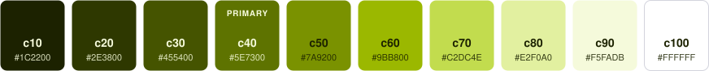
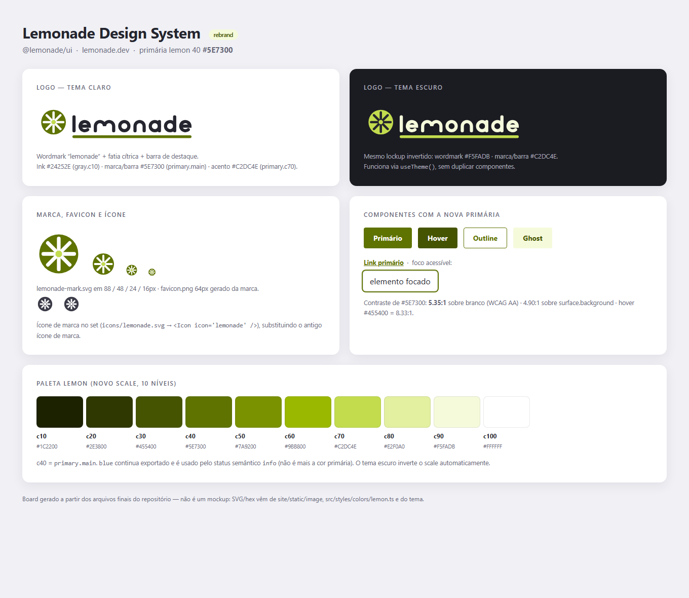

<div align="center">

<a href="https://lemonade-ui.llypedev.com.br">
  <picture>
    <source media="(prefers-color-scheme: dark)" srcset=".github/assets/logo-lemonade-dark.svg" />
    
  </picture>
</a>

### Implementação em React do Lemonade Design System

Componentes React acessíveis, personalizáveis por tema e totalmente tipados para construir interfaces consistentes.

[](https://github.com/llypeDev/lemonade-ui/actions/workflows/yarn.yml)
[](https://github.com/llypeDev/lemonade-ui/actions/workflows/loki.yml)
[](https://codecov.io/gh/llypeDev/lemonade-ui)
[](./LICENSE)


[**Documentação**](https://lemonade-ui.llypedev.com.br) ·
[**Storybook**](https://lemonade-ui.llypedev.com.br/storybook) ·
[**Primeiros passos**](https://lemonade-ui.llypedev.com.br/getting-started) ·
[**Como contribuir**](./CONTRIBUTING.md)

[English](./README.md) · **Português**

</div>

---

## Sumário

- [Destaques](#-destaques)
- [Instalação](#-instalação)
- [Início rápido](#-início-rápido)
- [Temas](#-temas)
- [Internacionalização](#-internacionalização)
- [Ícones](#-ícones)
- [Componentes](#-componentes)
- [Desenvolvimento](#-desenvolvimento)
- [Como contribuir](#-como-contribuir)
- [Licença](#-licença)

## ✨ Destaques

<table>
  <tr>
    <td width="33%" valign="top">
      <b>🧩 Mais de 50 componentes</b><br />
      Botões, formulários, seletores de data, tabelas, modais, toasts, abas e primitivas de layout.
    </td>
    <td width="33%" valign="top">
      <b>♿ Acessível</b><br />
      Segue o nível AA da WCAG: navegação por teclado, foco visível, atributos ARIA e contraste verificado.
    </td>
    <td width="33%" valign="top">
      <b>🎨 Temas</b><br />
      Temas claro e escuro prontos, e <code>createTheme</code> para usar suas próprias escalas de cor.
    </td>
  </tr>
  <tr>
    <td width="33%" valign="top">
      <b>🌍 Pronto para i18n</b><br />
      Os textos dos componentes vêm de um <code>LocaleContext</code>, com <code>en-US</code> e <code>pt-BR</code> incluídos.
    </td>
    <td width="33%" valign="top">
      <b>💠 470 ícones</b><br />
      Um conjunto completo de ícones SVG disponível por um único componente <code>&lt;Icon /&gt;</code>.
    </td>
    <td width="33%" valign="top">
      <b>🟦 TypeScript</b><br />
      Escrito em TypeScript e publicado com as declarações de tipo.
    </td>
  </tr>
</table>

## 📦 Instalação

**Requisitos:** React e React DOM `>= 16.8` (a biblioteca usa hooks).

```sh
# com npm
npm install @lemonade/ui --save

# com yarn
yarn add @lemonade/ui
```

### Fonte: IBM Plex Sans

O Lemonade foi desenhado para a [IBM Plex Sans](https://fonts.google.com/specimen/IBM+Plex+Sans), nos estilos _regular_ e _bold_. Adicione-a ao `<head>` da sua aplicação:

```html
<link href="https://fonts.googleapis.com/css?family=IBM+Plex+Sans:400,400i,700,700i" rel="stylesheet" />
```

## 🚀 Início rápido

Envolva a aplicação com o `ThemeProvider`. Além de fornecer o tema, ele injeta os estilos globais (fonte, cores, `box-sizing` e reset dos títulos) que os componentes esperam.

```jsx
import React from 'react'
import ReactDOM from 'react-dom'
import { Button, ThemeProvider } from '@lemonade/ui'

const App = () => (
  <ThemeProvider>
    <Button kind='primary'>Olá, mundo</Button>
  </ThemeProvider>
)

ReactDOM.render(<App />, document.querySelector('#root'))
```

Um exemplo um pouco maior, combinando componentes de layout, formulário e feedback:

```jsx
import { Alert, Button, Cell, Grid, Icon, TextField, Tooltip } from '@lemonade/ui'

function FormularioCadastro() {
  return (
    <Grid>
      <Cell size={12}>
        <Alert type='info'>Os campos marcados com * são obrigatórios.</Alert>
      </Cell>

      <Cell size={6}>
        <TextField name='nome' label='Nome' placeholder='Seu nome completo' required />
      </Cell>

      <Cell size={6}>
        <TextField name='email' label='E-mail' error='Informe um e-mail válido' required />
      </Cell>

      <Cell size={12}>
        <Tooltip text='Criar sua conta'>
          <Button kind='primary' type='submit'>
            <Icon icon='plus' style={{ marginRight: '0.5rem' }} />
            Cadastrar
          </Button>
        </Tooltip>
      </Cell>
    </Grid>
  )
}
```

O `Button` aceita `kind` (`normal` · `primary` · `danger`), `skin` (`default` · `outline` · `ghost`) e `size` (`small` · `medium` · `large`). Todas as props de cada componente estão no [Storybook](https://lemonade-ui.llypedev.com.br/storybook).

## 🎨 Temas

O Lemonade exporta dois temas: `lightTheme` (padrão) e `darkTheme`. O tema escuro inverte todas as escalas de cor, então os componentes se adaptam sem código extra.

```jsx
import { darkTheme, ThemeProvider } from '@lemonade/ui'

const App = () => <ThemeProvider theme={darkTheme}>{/* ... */}</ThemeProvider>
```

A cor da marca é a escala **lemon**. O `c40` (`#5E7300`) é o `pallete.primary.main` e tem contraste de 5,35:1 sobre o branco:

<p align="center">
  
</p>

### Tema personalizado

Use `createTheme` para montar um tema a partir de qualquer escala de cor. Todas as escalas estão em `colors` (`lemon`, `blue`, `gray`, `green`, `orange`, `pink`, `purple`, `red`, `turquoise` e `yellow`):

```jsx
import { Button, colors, createTheme, ThemeProvider } from '@lemonade/ui'

const meuTema = createTheme({
  pallete: {
    primaryScale: colors.pink,
  },
})

const App = () => (
  <ThemeProvider theme={meuTema}>
    <Button kind='primary'>Meu tema personalizado!</Button>
  </ThemeProvider>
)
```

Outras escalas que podem ser substituídas: `grayScale`, `successScale`, `dangerScale`, `alertScale`, `infoScale` e `highlightScale`.

### Estilizando seus próprios componentes

O `useStyles` dá acesso ao tema atual e devolve nomes de classe do Emotion, então seus componentes acompanham o tema (inclusive o modo escuro):

```jsx
import { useStyles } from '@lemonade/ui'

function Banner({ children }) {
  const { classes } = useStyles((theme) => ({
    banner: {
      padding: '1rem',
      background: theme.pallete.primary.c90,
      color: theme.pallete.primary.c10,
      borderRadius: theme.radius.paper,
    },
  }))

  return <div className={classes.banner}>{children}</div>
}
```

A maioria dos componentes também aceita a prop `style` com um objeto de estilos do Emotion, para ajustes pontuais. Use `useTheme()` quando precisar apenas ler valores do tema.

## 🌍 Internacionalização

Os textos dos componentes (paginação, calendário, mensagens de formulário etc.) vêm do `LocaleContext`. O inglês (`en-US`) é o padrão; o `pt-BR` já vem no pacote:

```jsx
import { LocaleContext, Paginator } from '@lemonade/ui'
import ptBR from '@lemonade/ui/lib/i18n/locales/pt-BR'

const App = () => (
  <LocaleContext.Provider value={ptBR}>
    <Paginator page={5} total={10} />
  </LocaleContext.Provider>
)
```

Para outro idioma, crie um objeto com o mesmo formato de `LocaleConfiguration` e passe-o ao provider. Leia os textos atuais com a hook `useLocale()`.

## 💠 Ícones

Todos os ícones são renderizados pelo componente `Icon`. O nome é a forma camelCase do nome do arquivo SVG em [`icons/`](./icons) (por exemplo, `angle-down.svg` → `angleDown`):

```jsx
import { Icon } from '@lemonade/ui'

<Icon icon='lemonade' />
<Icon icon='checkCircleFilled' fill='success' size={2} />
```

| Prop    | Descrição                                                                                                                                |
| ------- | ---------------------------------------------------------------------------------------------------------------------------------------- |
| `icon`  | Nome do ícone, ou qualquer componente React de SVG.                                                                                      |
| `fill`  | Cor do tema: `normal`, `primary`, `secondary`, `disabled`, `danger`, `success`, `info`, `alert` ou `inherit`. O padrão é `currentColor`. |
| `size`  | Tamanho em `rem`. O padrão é `1.5`.                                                                                                      |
| `style` | Estilos extras do Emotion.                                                                                                               |

Veja o conjunto completo de ícones em [lemonade-ui.llypedev.com.br](https://lemonade-ui.llypedev.com.br).

### Ícones Phosphor

O Lemonade também inclui a família completa [Phosphor](https://phosphoricons.com) — 1.512 ícones, cada um em seis pesos (`thin`, `light`, `regular`, `bold`, `fill`, `duotone`). Cada ícone é um componente exportado por `@lemonade/ui/phosphor` com o prefixo `Ph`; importe apenas o que usar e os bundlers descartam o resto:

```jsx
import { Icon } from '@lemonade/ui'
import { PhAirplane, PhHeart, PhosphorIconProvider } from '@lemonade/ui/phosphor'

<PhAirplane />
<PhHeart weight='fill' size={32} color='#5E7300' />
<Icon icon={PhHeart} fill='primary' size={2} />

<PhosphorIconProvider weight='duotone' size={24}>{/* padrões para todos os ícones dentro */}</PhosphorIconProvider>
```

Busque, visualize, copie e baixe os ícones no [explorador Phosphor](https://lemonade-ui.llypedev.com.br/pt/design-guidelines/iconography/phosphor). Os ícones Phosphor têm licença MIT — veja o [THIRD_PARTY_NOTICES.md](./THIRD_PARTY_NOTICES.md).

## 🧩 Componentes

| Categoria             | Componentes                                                                                                                                                        |
| --------------------- | ------------------------------------------------------------------------------------------------------------------------------------------------------------------ |
| **Ações**             | `Button` · `ButtonGroup` · `Dropdown` · `Link`                                                                                                                     |
| **Formulários**       | `TextField` · `TextArea` · `MaskedTextField` · `Select` · `SelectInline` · `Combobox` · `Checkbox` · `Radio` · `Switch` · `FileUploader` · `FormControl` · `Input` |
| **Data e hora**       | `Calendar` · `DateField` · `DateRangePicker` · `TimeField` · `MonthField` · `MonthPicker` · `MonthRangePicker` · `MonthPaginator`                                  |
| **Feedback**          | `Alert` · `ActionableToast` · `Modal` · `Tooltip` · `Spinner` · `Progress` · `Status` · `Tag` · `InfoLabel`                                                        |
| **Navegação**         | `Breadcrumb` · `Tabs` · `Paginator` · `Stepper`                                                                                                                    |
| **Exibição de dados** | `Table` · `DataTable` · `PagedTable` · `Number` · `Currency` · `Highlight` · `Icon`                                                                                |
| **Layout**            | `Grid` · `Cell` · `Flow` · `HFlow` · `VFlow` · `Card` · `Paper` · `StickyContainer` · `Portal` · `RootRef`                                                         |
| **Tipografia**        | `Text` · `Heading` · `HeadingSection`                                                                                                                              |

Exemplos interativos e a API completa de cada componente estão no [Storybook](https://lemonade-ui.llypedev.com.br/storybook). As diretrizes de uso estão em [lemonade-ui.llypedev.com.br](https://lemonade-ui.llypedev.com.br).

<details>
<summary><b>🍋 Brand board</b></summary>
<br />

<p align="center">
  
</p>

</details>

## 🛠 Desenvolvimento

**Requisitos:** [Git](https://git-scm.com/), [Node.js 16+](https://nodejs.org/) e [Yarn](https://yarnpkg.com/).

```sh
git clone https://github.com/llypeDev/lemonade-ui.git
cd lemonade-ui
yarn install

# desenvolva os componentes no Storybook (http://localhost:6006)
yarn storybook

# rode os testes em modo watch
yarn test:watch
```

### Scripts

| Comando                  | O que faz                                                                      |
| ------------------------ | ------------------------------------------------------------------------------ |
| `yarn storybook`         | Inicia o servidor de desenvolvimento do Storybook na porta `6006`.             |
| `yarn build`             | Compila o TypeScript e gera o bundle UMD em `lib/`.                            |
| `yarn start`             | Compila o TypeScript em modo watch.                                            |
| `yarn test`              | Roda o ESLint e todos os testes do Jest (incluindo os de snapshot).            |
| `yarn test:watch`        | Roda o Jest em modo watch.                                                     |
| `yarn test:loki`         | Gera o Storybook e roda os testes de regressão visual do Loki (requer Docker). |
| `yarn lint`              | Roda o ESLint em `src/`.                                                       |
| `yarn icons`             | Regenera os componentes de ícone a partir dos SVGs em `icons/`.                |
| `yarn phosphor:sync`     | Baixa e verifica uma versão do Phosphor em `vendor/phosphor/`.                 |
| `yarn phosphor:generate` | Regenera os componentes Phosphor em `src/phosphor/generated/`.                 |
| `yarn build-storybook`   | Gera um Storybook estático em `storybook-static/`.                             |
| `yarn site:start`        | Inicia o site de documentação em Gatsby (rode `yarn build` antes).             |

### Estrutura do projeto

```
lemonade-ui/
├── icons/              # SVGs de origem do conjunto de ícones
├── site/               # Site de documentação em Gatsby (lemonade-ui.llypedev.com.br)
├── src/
│   ├── components/     # Uma pasta por componente, com stories e testes
│   ├── hooks/          # Hooks React compartilhados
│   ├── i18n/           # LocaleContext e textos dos locales (en-US, pt-BR)
│   ├── phosphor/       # Componentes dos ícones Phosphor (@lemonade/ui/phosphor)
│   ├── styles/         # Temas, escalas de cor, CSS global, useStyles/useTheme
│   └── util/           # Funções auxiliares
├── tools/              # Scripts de geração dos ícones (inclui tools/phosphor)
├── vendor/phosphor/    # SVGs, catálogo e licença MIT do Phosphor versionados
└── .loki/              # Imagens de referência da regressão visual
```

### Verificações de qualidade

- **Testes unitários e de snapshot:** [Jest](https://jestjs.io/) e [Testing Library](https://testing-library.com/), com cobertura enviada ao [Codecov](https://codecov.io/gh/llypeDev/lemonade-ui).
- **Regressão visual:** o [Loki](https://loki.js.org/) tira uma captura de cada story e compara com as referências em `.loki/`. Se a mudança visual for intencional, regenere as referências com o workflow _Update Loki references_ no GitHub Actions.
- **Acessibilidade:** o Storybook inclui o [addon a11y](https://storybook.js.org/addons/@storybook/addon-a11y) para auditar cada story.
- **Formatação:** o [Prettier](https://prettier.io/) roda nos arquivos em stage antes de cada commit.

Mais detalhes, incluindo como publicar uma nova versão, estão no [guia de contribuição](./CONTRIBUTING.md).

## 🤝 Como contribuir

Contribuições são bem-vindas! Antes de abrir uma issue ou um pull request, leia o [guia de contribuição](./CONTRIBUTING.md). As issues devem ser escritas em inglês, e há templates para:

- 🐛 [Relatar bugs](https://github.com/llypeDev/lemonade-ui/issues/new?template=bug_report.md)
- ♿ [Problemas de acessibilidade](https://github.com/llypeDev/lemonade-ui/issues/new?template=accessibility-bug-report-.md)
- ⭐ [Propor novos componentes](https://github.com/llypeDev/lemonade-ui/issues/new?template=proposing-new-components.md)
- ✏️ [Alterar um componente existente](https://github.com/llypeDev/lemonade-ui/issues/new?template=amend-to-an-existing-pattern.md)

## 📄 Licença

[MIT](./LICENSE) © Lemonade
